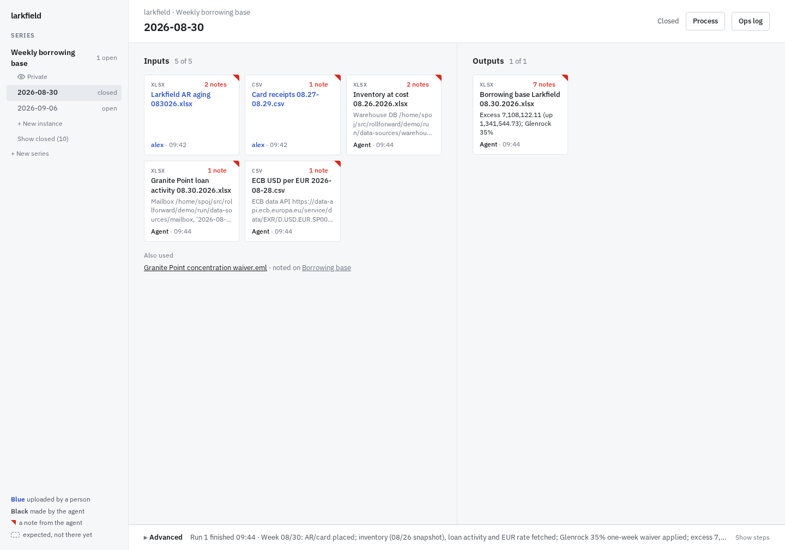
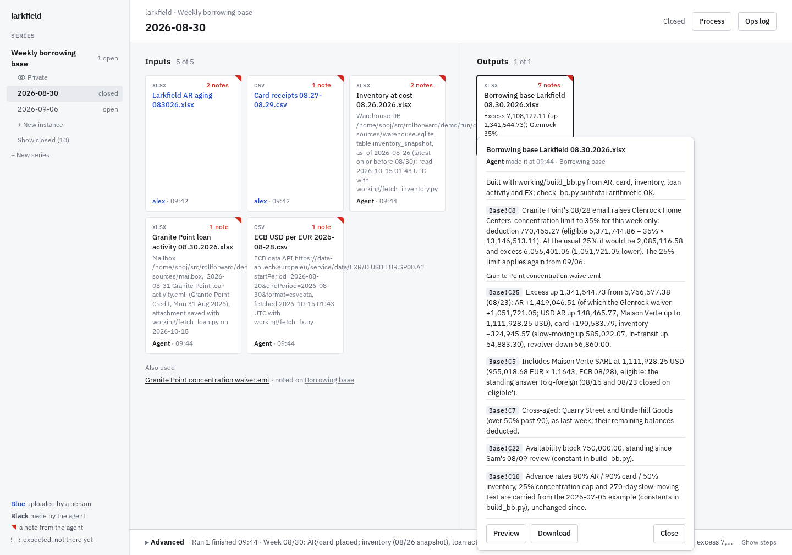
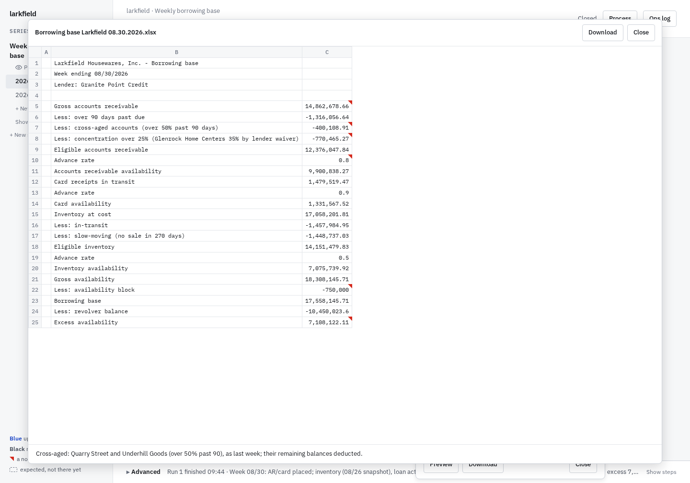
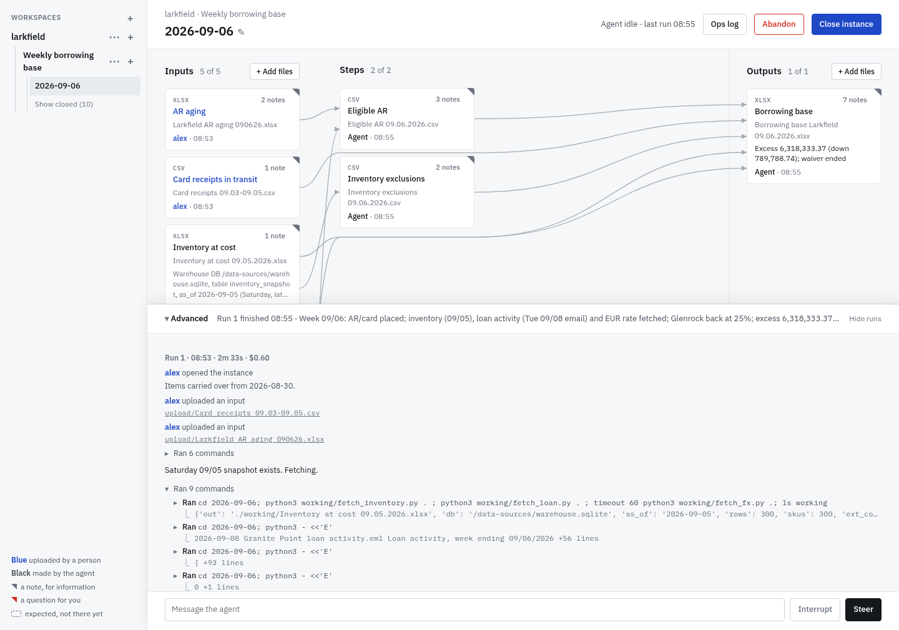
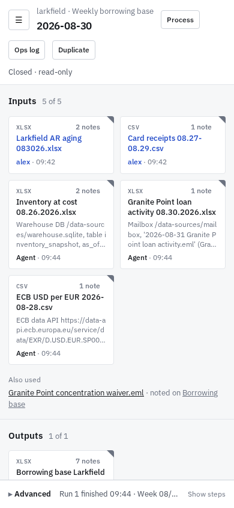

# rollforward

Recurring tasks, files in and files out. People drop this period's input files into an instance of a series. An agent learns the transform from the closed instances, produces the output files, and pins notes and questions to the cells they're about. People answer by clicking an option, replace a file by dropping a new one, and close the instance when it's done. There is no prompt box on the main screen.

- **The agent** is [Pi](https://www.npmjs.com/package/@earendil-works/pi-coding-agent), run over RPC with read, bash, edit and write tools, in the series folder. It copies and adapts the previous instance's scripts, so each instance's `working/` is a complete record of how its outputs were made.
- **Inputs** are uploads, or sources a person points the agent to, such as a database, a mailbox folder or a web API. The agent keeps a frozen copy of what it read, and the tile shows where it came from.
- **Series can share.** A series can let other series read it, one way.
- **Everything is files on disk.** Each instance has `upload/` (people's files), `working/` (the agent's), `workspace.json` (what the screen shows) and `log.jsonl` (every event).

| A tile's notes | Preview, compared with the file it replaced |
|---|---|
|  |  |
| **Advanced: the agent's steps** | **Phone** |
|  |  |

## Try it

    cp .env.example .env          # set OPENROUTER_API_KEY
    docker compose up --build     # then open http://127.0.0.1:8780

The image comes with a demo series that is already populated: a weekly borrowing base for a made-up housewares company, nine weeks the agent has done.
- **Week 08-16:** the agent starts fetching the inventory from a warehouse database, the lender's figures from a mailbox and the EUR rate from the ECB.
- **Week 08-30:** it handles a stale snapshot and a one-week waiver from the lender.
- **Week 09-06:** open it and drop the two files from `demo/try/2026-09-06/`. The agent fetches the inventory from the warehouse database, the loan activity from the mailbox and the EUR rate from the ECB.
- **Things to open:** a tile, Preview, Process, the ops log and Advanced.
- **Running the agent:** create an instance and drop files. A normal week costs about $0.20–0.60 with Claude Opus 5.5 through OpenRouter.

**Security:** there is no sign-in, and the agent runs shell commands inside the container, which can read the API key and every series. Keep it on localhost or a private network such as Tailscale.

## Without Docker

You need Node 26 and uv. LibreOffice is optional, for recalculating formula workbooks.

    npm install
    uv venv .venv && uv pip install --python .venv/bin/python -r requirements.txt
    node src/server.ts DATA_ROOT [PORT]

The [justfile](justfile) has these and more as recipes; `just` lists them.

- **Pi credentials:** Pi needs `OPENROUTER_API_KEY` or a Pi login.
- **Pi settings:** `"steeringMode": "all"` in `~/.pi/agent/settings.json`.
- **Environment variables:**
  - `RF_MODEL` (default `openrouter/anthropic/claude-opus-5.5`)
  - `RF_THINKING` (`high`)
  - `RF_LIMIT_MIN` (120)
  - `RF_PI_ARGS` (a JSON array of extra Pi arguments)
  - `RF_HOST` (`127.0.0.1`)

To build the demo from scratch (about $4 of model use; the generator needs the internet for the ECB rates):

    .venv/bin/python demo/make_demo.py demo/out
    .venv/bin/python demo/run_demo.py demo/out http://127.0.0.1:8780 DATA_ROOT

## More

- [PLAN.md](PLAN.md): the design and the decisions.
- [prompt.md](prompt.md): the agent's instructions.
- [docs/design.md](docs/design.md): the look.
